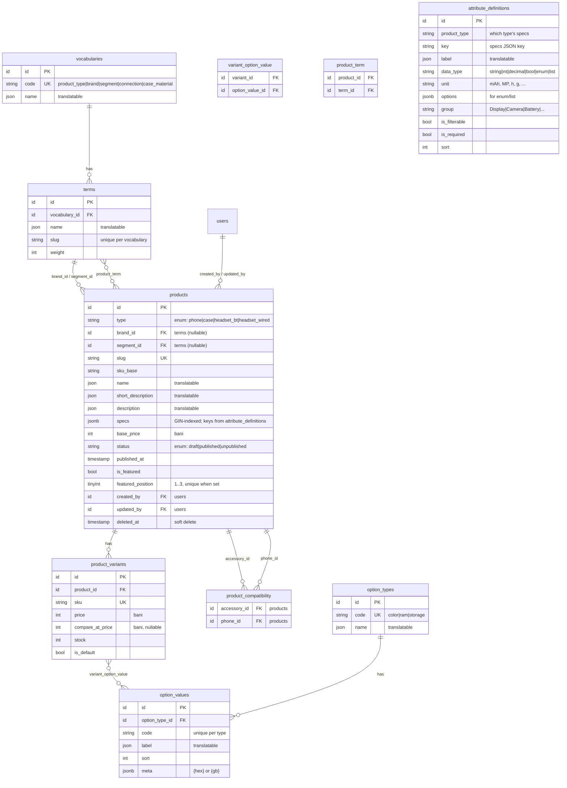

# ERD — Catalog (milestone 3)

Entity-relationship diagram for the catalog schema. Money is integer **bani**; translatable
fields (`name`, `label`, `description`, …) are JSON per locale (EN + RO). See
[`.claude/context/content-model.md`](../.claude/context/content-model.md) for field-level notes.

`attribute_definitions` has no FK to `products` — it's a **schema catalog** matched by
`product_type` + `key`, driving the dynamic spec form, the PDP spec table and `SpecsValidator`.
